# Practice 2 - RIP security lab with Podman

I am doing this lab with 4 FRR routers and 1 client. My goal is to check normal RIP behavior, then inject a fake route, poison a route, and apply a basic mitigation.

## 1. Requirements

```bash
sudo apt update
sudo apt install podman podman-compose
podman --version
podman-compose --version
```

Requirements:

- podman 6.1.4-1.1
- podman-desktop 1.29.3-1.1
- podman-compose 1.6.0-1
- podman-docker 6.1.4-1.1
- quay.io/frrouting/frr:10.4.2

This lab was tested with FRR 10.4.2. In this image, `show ip protocols` does not work, so the correct command is `show ip rip`.

The Podman workaround is to use `/29` inter-router subnets instead of `/30` because Podman reserves the gateway and the point-to-point link pattern breaks in this environment.

## 2. Topology

Topology image:

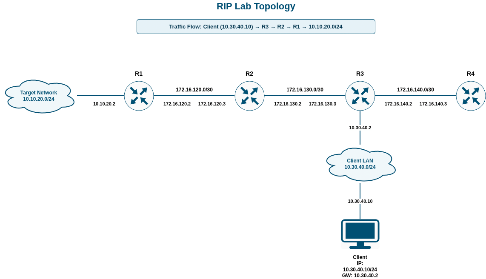

IP plan:

- R1: `10.10.20.2` on `10.10.20.0/24`
- R1-R2: `172.16.120.0/29` -> `172.16.120.2` and `172.16.120.3`
- R2-R3: `172.16.130.0/29` -> `172.16.130.2` and `172.16.130.3`
- R3-R4: `172.16.140.0/29` -> `172.16.140.2` and `172.16.140.3`
- R3 client LAN: `10.30.40.0/24`
- Client: `10.30.40.10` with default via `10.30.40.2`

This is the same lab pattern as the original one, but the private addresses are adjusted to avoid host conflicts and Podman networking problems.

This is the same lab pattern as the original one, but the private addresses are adjusted to avoid host conflicts and Podman networking problems.

## 3. Why the Podman version is different

Podman keeps the subnet gateway and is stricter than a plain Docker lab. In practice, the original `/30` links were not working cleanly here because the gateway and broadcast addresses left no usable second host on the link.

So I changed the inter-router links to `/29` networks to keep the same lab logic but make it work in Podman.

## 4. Compose file

The `rip-security-lab/docker-compose.yaml` file is created as follows:

```yaml
services:
  r1:
    image: quay.io/frrouting/frr:10.4.2
    container_name: rip-r1
    privileged: true
    command: ["/bin/sh", "/tmp/router-start.sh"]
    volumes:
      - ./router-start.sh:/tmp/router-start.sh:ro
      - ./r1/daemons:/etc/frr/daemons:ro
      - ./r1/frr.conf:/etc/frr/frr.conf
    networks:
      r1_r2:
        ipv4_address: 172.16.120.2
      r1_lan:
        ipv4_address: 10.10.20.2

  r2:
    image: quay.io/frrouting/frr:10.4.2
    container_name: rip-r2
    privileged: true
    command: ["/bin/sh", "/tmp/router-start.sh"]
    volumes:
      - ./router-start.sh:/tmp/router-start.sh:ro
      - ./r2/daemons:/etc/frr/daemons:ro
      - ./r2/frr.conf:/etc/frr/frr.conf
    networks:
      r1_r2:
        ipv4_address: 172.16.120.3
      r2_r3:
        ipv4_address: 172.16.130.2

  r3:
    image: quay.io/frrouting/frr:10.4.2
    container_name: rip-r3
    privileged: true
    command: ["/bin/sh", "/tmp/router-start.sh"]
    volumes:
      - ./router-start.sh:/tmp/router-start.sh:ro
      - ./r3/daemons:/etc/frr/daemons:ro
      - ./r3/frr.conf:/etc/frr/frr.conf
    networks:
      r2_r3:
        ipv4_address: 172.16.130.3
      r3_r4:
        ipv4_address: 172.16.140.2
      client_lan:
        ipv4_address: 10.30.40.2

  r4:
    image: quay.io/frrouting/frr:10.4.2
    container_name: rip-r4
    privileged: true
    command: ["/bin/sh", "/tmp/router-start.sh"]
    volumes:
      - ./router-start.sh:/tmp/router-start.sh:ro
      - ./r4/daemons:/etc/frr/daemons:ro
      - ./r4/frr.conf:/etc/frr/frr.conf
    networks:
      r3_r4:
        ipv4_address: 172.16.140.3

  rip-check-tcpdump:
    image: docker.io/nicolaka/netshoot:latest
    container_name: rip-check-tcpdump
    privileged: true
    command: ["sh", "-c", "sleep infinity"]
    networks:
      r1_r2:
        ipv4_address: 172.16.120.4
      r2_r3:
        ipv4_address: 172.16.130.4
      r3_r4:
        ipv4_address: 172.16.140.4
      client_lan:
        ipv4_address: 10.30.40.20

  client:
    image: alpine:latest
    container_name: rip-client
    privileged: true
    command: ["sh", "-c", "ip route del default via 10.30.40.1 || true; ip route replace default via 10.30.40.2; sleep infinity"]
    networks:
      client_lan:
        ipv4_address: 10.30.40.10

networks:
  r1_r2:
    ipam:
      config:
        - subnet: 172.16.120.0/29
  r2_r3:
    ipam:
      config:
        - subnet: 172.16.130.0/29
  r3_r4:
    ipam:
      config:
        - subnet: 172.16.140.0/29
  r1_lan:
    ipam:
      config:
        - subnet: 10.10.20.0/24
  client_lan:
    ipam:
      config:
        - subnet: 10.30.40.0/24
```


router start script is only for podman version 

```text 
#!/bin/sh

ip route del default via 10.10.20.1 || true;
ip route del default via 172.16.120.1 || true;
ip route del default via 172.16.130.1 || true;
ip route del default via 172.16.140.1 || true;
ip route del default via 10.30.40.1 || true;
sysctl -w net.ipv4.ip_forward=1;
apk update >/dev/null 2>&1 || true;
apk add --no-cache tcpdump >/dev/null 2>&1 || true;
exec /usr/lib/frr/docker-start
```  

## 5. FRR router config

The router configuration is stored in the FRR files for each container. This lab does not require a separate command-by-command section for every router; the working config is loaded automatically at startup from the matching `frr.conf` files.

Each router needs a `daemons` file like this:

```text
zebra=yes
ripd=yes
```

And the `frr.conf` files look like this:

R1:

```text
frr defaults traditional
hostname R1
log stdout
!
router rip
 version 2
 network 10.10.20.0/24
 network 172.16.120.0/29
!
```

- R1 advertises the destination LAN and the link toward R2.

R2:

```text
frr defaults traditional
hostname R2
log stdout
!
router rip
 version 2
 network 172.16.120.0/29
 network 172.16.130.0/29
!
```

- R2 is the transit router between R1 and R3, so it advertises both links.

R3:

```text
frr defaults traditional
hostname R3
log stdout
!
router rip
 version 2
 network 172.16.130.0/29
 network 172.16.140.0/29
 network 10.30.40.0/24
!
```

-  R3 connects the core path to the client LAN and to R4, so it advertises both interfaces.

R4:

```text
frr defaults traditional
hostname R4
log stdout
!
router rip
 version 2
 network 172.16.140.0/29
!
```

- R4 is the attacker / malicious router in this lab, and it only needs to advertise its side of the R3-R4 link.

## 6. Start the lab

```bash
cd rip-security-lab
podman compose down -v --remove-orphans
podman network prune -f
podman compose up -d --force-recreate
podman ps
```

If the lab was previously created with a different subnet size or an older /30 layout, do a full cleanup before starting again. In Podman, stale networks are often the reason the route tables look fine in the config but fail during the rebuild.

The lab should show 6 containers running:


- rip-r1
- rip-r2
- rip-r3
- rip-r4
- rip-check-tcpdump
- rip-client

## Phase 1: Normal RIP operation

At the end of this phase, students should confirm that the destination network is reachable and that the routing tables contain the expected RIP-learned route.

This is the baseline. The client should be able to reach `10.10.20.2`.

Before it worked correctly in Podman, the lab had a routing issue. The environment was adding stale default routes on the container interfaces, and IPv4 forwarding was disabled. RIP routes appeared, but traffic was not actually being forwarded, so the network looked active but it was not passing packets.

The fix is simple, remove the unwanted default routes and enable `net.ipv4.ip_forward=1` before starting FRR.

Important fix for Podman:

- remove stale default routes on the interfaces
- enable IPv4 forwarding

This issue is shown in the Podman subnet problem image:

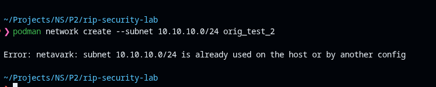

If the network does not forward traffic, this is usually the issue in this environment.

Check R3 with:

```bash
vtysh
show ip route
show ip rip
```

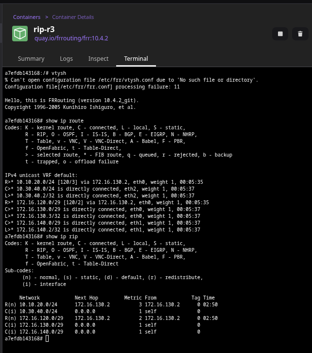


Then test from the client:

```bash
ping -c 3 10.10.20.2
traceroute 10.10.20.2
```

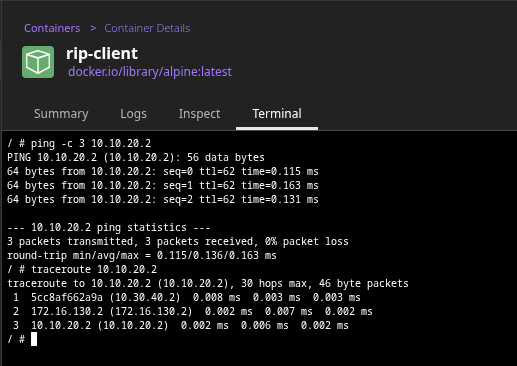


Now I want to check the RIP traffic itself. This helps confirm that the routers are really exchanging routing updates on UDP port 520, not just that the routes appear in the routing table. The FRR router image does not include `tcpdump`, and in Podman the router namespaces are not the easiest place to capture from. For that reason, I create a small helper container called `rip-check-tcpdump` using `docker.io/nicolaka/netshoot:latest`, because that image already contains networking tools like `tcpdump`, `ip`, and `ping`. It is attached to the same lab networks so we can capture the traffic without changing the router config.

```bash
tcpdump -n -i eth1 udp port 520
```


Things to check in this phase:

- R3 has a route to `10.10.20.0/24`
- the client can ping `10.10.20.2`
- the path is `Client -> R3 -> R2 -> R1`
- RIP is active 

## Phase 2: Malicious route manipulation

Students must determine:
- Whether R3 receives the false routing information.   
- What metric is associated with the advertised route.   
- Whether R3 changes its preferred route.   
- Whether the forwarding path changes.   
- Whether communication with the destination network is affected.   
- What security consequences result from accepting unauthorized routing information.  

In this phase, R4 is introduced as a controlled malicious router. R4 is connected to R3 through the `172.16.140.0/29` link and participates in the same RIP domain. The objective is to show the security problem of accepting routing information from an untrusted router.

R4 introduces false routing information for the legitimate destination network `10.10.20.0/24`. Students monitor R3 while the manipulated route is injected.

On R4, inject the fake route:

```bash
vtysh
conf t

router rip
version 2
redistribute static
exit
ip route 10.10.20.0/24 Null0
end
```

dont use write, its shit, hard to undo the process, becomes messy, Halp me :C


Then check on R3:

```bash
vtysh
show ip route 10.10.20.0/24
show ip rip
```


and check the RIP traffic capture
```bash
tcpdump -n -i any udp port 520
```


and do again the ping in the client 

```bash
ping -c 3 10.10.20.2
```


The traffic is no longer going to the real `10.10.20.2` server. It is being sent toward the fake route, and therefore the client loses connectivity.

In this phase, the proof is not only the route table. It is the combination of three checks: R3 shows the malicious route in `show ip route`, the RIP update is seen in `tcpdump` as coming from `172.16.140.3`, and the client ping fails because the path has been redirected to the blackhole route advertised by R4. Together these results show that the malicious router is influencing the forwarding decision and that trust in unauthorised RIP information can disrupt traffic.

Things to check in this phase:

- whether R3 receives the false route
- what metric is associated with the advertised route
- whether R3 changes its preferred route
- whether the forwarding path changes
- whether communication to `10.10.20.0/24` is affected
- what security consequences result from accepting unauthorised routing information


## Phase 3: Route poisoning with metric 16

Students should record the routing table before, during, and after the failure and capture the
corresponding RIP updates.

This phase is done after a clean rebuild. In Podman, shutting down only one side of the link is not reliable, so both sides of the R1-R2 link must be brought down.

First, rebuild the lab:

```bash
podman compose down -v --remove-orphans
podman network prune -f
podman compose up -d --force-recreate
```

Then check that the baseline is working before the failure.

On R3:

```bash
vtysh
show ip route 10.10.20.0/24
```


On the client:

```bash
ping -c 3 10.10.20.2
```

The ping should work. If the route is not visible immediately, wait a few seconds and check again. In Podman, FRR may need a short time to converge.

Now disable both ends of the R1-R2 link:

On R1 and R2:

```bash
ip link set dev eth0 down
```

Then check R3 again:

```bash
vtysh
show ip route 10.10.20.0/24
show ip rip
```


Expected result: the route is marked as poisoned with metric 16, for example `R(n) 10.10.20.0/24 ... metric 16`.

This is the key point: in RIP, a metric of 16 means the route is poisoned or unreachable. If we see `metric 16`, Phase 3 is working.

Then restore the link on both sides:

```bash
ip link set dev eth0 up
```

Check again on R3:

```bash
vtysh
show ip route 10.10.20.0/24
show ip rip
```

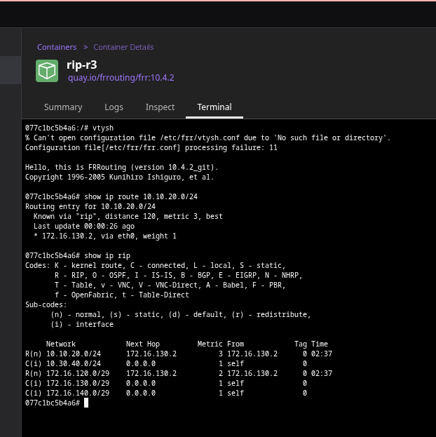

This is the Phase 3 proof for this Podman lab: route poisoning appears only after a clean rebuild and a failure on both ends of the R1-R2 link. Record the route state before, during, and after the failure.

## Phase 4 - Mitigation and security evaluation

The goal of this phase is to repeat the same malicious route‑manipulation experiment from Phase 2 after applying a security control, and to compare the results against the Phase 2 baseline across four dimensions: routing table, RIP traffic, connectivity, and forwarding path.

Three controls are evaluated in isolation:

- Control A — Restrict RIP to trusted interfaces
- Control B — Passive interface on the untrusted link
- Control C — Inbound route filtering (distribute-list + prefix-list)

Each control is tested on a clean rebuild followed by a re‑injection of the Phase 2 poison. The controls are not chained, because each one changes the R3 state in a way that would invalidate the next test (Control A removes the RIP link entirely; Control B leaves a stale fake route; Control C needs a clean baseline to show the route was rejected, not merely never installed).

To avoid re‑typing the poison commands by hand, the injection is automated by rip-security-lab/poison-r4.sh. The script injects the fake route on R4 and verifies three things before returning:

1. R4 has the static blackhole route (10.10.20.0/24 -> Null0)

2. R4 is advertising it into RIP (show ip rip on R4 contains 10.10.20.0/24)

3. Whether R3 has accepted the poisoned route (polls show ip route on R3 for up to 20 s)


### Phase 2 baseline (no mitigation)

Steps
```bash
podman compose down -v --remove-orphans
podman network prune -f
podman compose up -d --force-recreate
./poison-r4.sh

# in r3
vtysh -c "show ip route 10.10.20.0/24"

# in client
ping -c 3 10.10.20.2
```

esta captura puede ser opcional, es repetir lo de antes lo que pasa es que lo he metido en un script + check para automatizar 

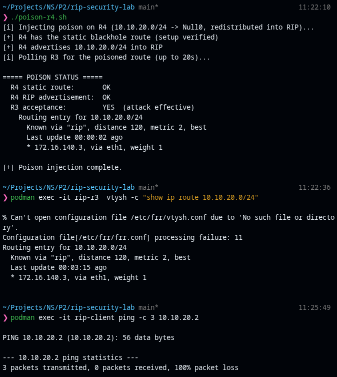

This is the attack state every control is compared against.

### Control A — Restrict RIP to trusted interfaces

R3 does not run RIP on the R3‑R4 link at all. No adjacency, no RIP processing on that interface.

Steps 
```Bash
podman compose down -v --remove-orphans
podman network prune -f
podman compose up -d --force-recreate

# inc r3
vtysh
conf t
router rip
 version 2
 no network 172.16.140.0/29
end

``` 

results

- Routing table:	Fake route not installed; legitimate route via 172.16.130.2 remains
- RIP traffic:	No RIP packets from 172.16.140.3
- Connectivity:	ping succeeds
- Forwarding path:	Client → R3 → R2 → R1


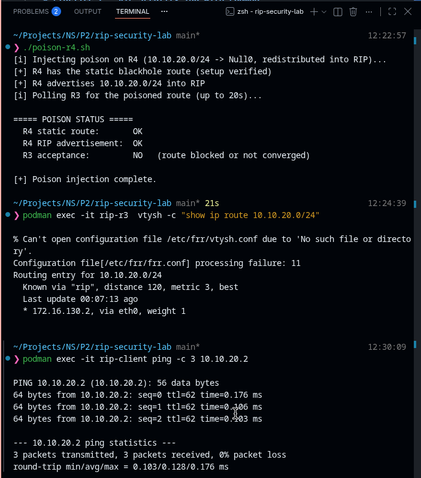

After removing 172.16.140.0/29 from RIP, show ip route 10.10.20.0/24 on R3 shows only the legitimate route via 172.16.130.2 (no 172.16.140.3 next hop), and ping -c 3 10.10.20.2 from the client succeeds. The fake route was never installed.

opinion: Effective, but coarse ,it removes the entire link from the RIP domain. Appropriate only when the segment is explicitly untrusted and needs no legitimate routing exchange.

### Control B — Passive interface on the untrusted link

R3 stops sending RIP updates on eth1, but continues to accept incoming updates. This sub‑phase is included specifically to show that passive‑interface is not a security control against a malicious sender.

steps 

```bash
podman compose down -v --remove-orphans
podman network prune -f
podman compose up -d --force-recreate

# in r3 
vtysh 
conf t
router rip
 version 2
 passive-interface eth1
end


./poison-r4.sh          # expected POISON STATUS: R3 acceptance = YES

podman exec -it rip-r3  vtysh -c "show ip route 10.10.20.0/24"
podman exec -it rip-client ping -c 3 10.10.20.2
```  


results 

- Routing table:	Fake route still installed via 172.16.140.3
- RIP traffic:	Fake update still received on eth1
- Connectivity:	ping still fails
- Forwarding path:	Still Client → R3 → R4 → * * *

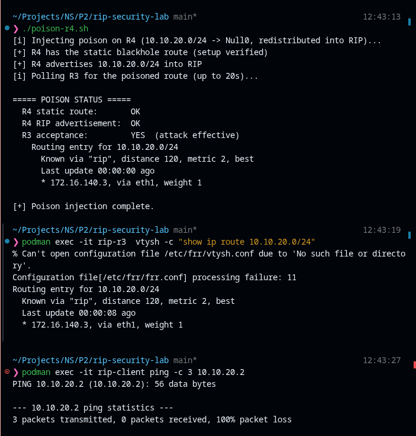

Passive‑interface does not stop the attack. It is useful hygiene (it stops R3 leaking its routes toward the untrusted segment) but it is not a defence against a malicious sender


### Control C — Inbound route filtering (distribute-list + prefix-list)

R3 explicitly drops any inbound RIP update received on eth1 that advertises 10.10.20.0/24. The filter runs after the update arrives but before the route is installed, so RIP stays operational on the link while the malicious prefix is rejected.

Steps

```bash
podman compose down -v --remove-orphans
podman network prune -f
podman compose up -d --force-recreate

#in r3
vtysh 
conf t
ip prefix-list BLOCK_FAKE seq 5 deny 10.10.20.0/24
ip prefix-list BLOCK_FAKE seq 10 permit any
router rip
 version 2
 distribute-list prefix BLOCK_FAKE in eth1
end

# in r3
show ip rip status     # screenshot 4 (filter active)

./poison-r4.sh          # expected POISON STATUS: R3 acceptance = NO

podman exec -it rip-r3  vtysh -c "show ip route 10.10.20.0/24"
podman exec -it rip-client ping -c 3 10.10.20.2
``` 

result 
- Routing table:	Fake route not installed; legitimate route via 172.16.130.2 preserved
- RIP traffic:	Update still visible on the wire, but discarded by R3
- Connectivity:	ping succeeds
- Forwarding: path	Client → R3 → R2 → R1


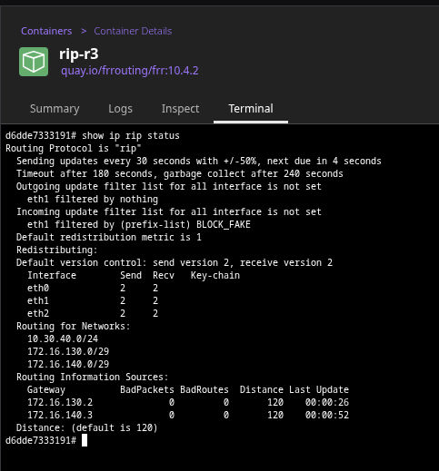
show ip rip status on R3 shows the line Incoming update filter list for eth1 is BLOCK_FAKE, confirming the inbound filter is attached to the untrusted interface before the attack is launched.


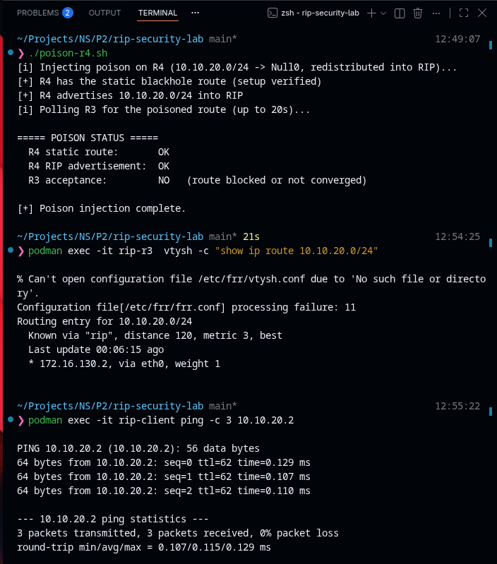
 After the inbound filter and the re‑injected poison, show ip route 10.10.20.0/24 on R3 shows only the legitimate route via 172.16.130.2 (top), and ping -c 3 10.10.20.2 from the client succeeds (bottom). R4's update was received on the wire but discarded before installation.

opinion: A precise mitigation. It targets exactly the malicious prefix while keeping RIP operational on the link.


### D Segmenting the routing infrastructure
R3 is the boundary between the trusted core (R1–R2–R3) and the untrusted segment (R4). Segmentation means the untrusted link exchanges no routes in either direction: R3 neither installs anything from R4 nor leaks any core prefix to R4. This is stronger than Control C, which only blocks one specific prefix inbound; D blocks the whole routing exchange on that link.

```bash
podman compose down -v --remove-orphans
podman network prune -f
podman compose up -d --force-recreate

# in r3
vtysh 
conf t
ip prefix-list DENY_ALL seq 5 deny 0.0.0.0/0 le 32
router rip
 version 2
 distribute-list prefix DENY_ALL in eth1
 distribute-list prefix DENY_ALL out eth1
end

./poison-r4.sh          # expected POISON STATUS: R3 acceptance = NO

# R3 side: no fake route, legitimate route present
podman exec -it rip-r3  vtysh -c "show ip route 10.10.20.0/24"
podman exec -it rip-r3  vtysh -c "show ip rip status"

# R4 side: no core routes learned (proof of outbound filtering)
podman exec -it rip-r4  vtysh -c "show ip rip"

# Client still works
podman exec -it rip-client ping -c 3 10.10.20.2
```
Result
- Routing table on R3:	Fake route not installed; legitimate route via 172.16.130.2 preserved
- R4's RIP database:	Empty of learned routes — R3 advertises nothing to R4
- RIP traffic:	R4's update arrives but is dropped by the inbound filter
- Connectivity:	ping succeeds
- Forwarding path:	Client → R3 → R2 → R1

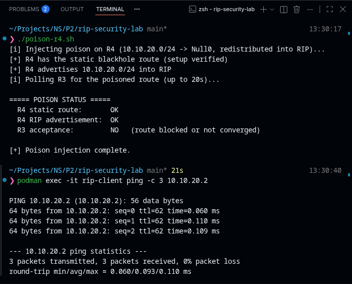
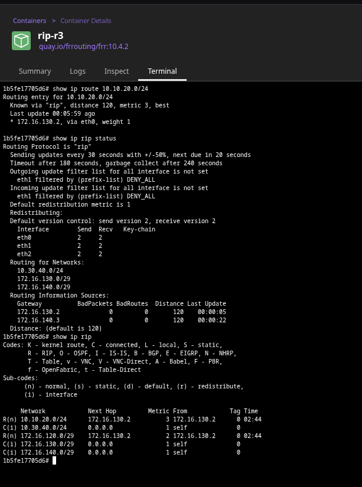

Top: show ip route 10.10.20.0/24 on R3 shows only the legitimate route via 172.16.130.2. Middle: show ip rip on R4 shows no routes learned from R3 (outbound filter working). Bottom: client ping -c 3 10.10.20.2 succeeds.

This is defense in depth at the boundary. It blocks the attack in both directions and prevents R4 from even learning the existence of the core prefixes which also removes a reconnaissance advantage from the attacker. 
  Cost: any future legitimate peer on that link would need an explicit exception to DENY_ALL

### E Controlling which devices are permitted to participate
RIP updates received on eth1 are checked against the source IP of the sending router. Only explicitly authorised peers are allowed; R4's IP (172.16.140.3) is not on the list, so every update from R4 is rejected regardless of which prefix it advertises.

```bash
podman compose down -v --remove-orphans
podman network prune -f
podman compose up -d --force-recreate

#in r3 
vtysh 
conf t
access-list TRUSTED_PEERS seq 10 permit 172.16.130.2
access-list TRUSTED_PEERS seq 20 deny any
router rip
 version 2
 distribute-list TRUSTED_PEERS in eth1
end

./poison-r4.sh          # expected POISON STATUS: R3 acceptance = NO

podman exec -it rip-r3  vtysh -c "show ip route 10.10.20.0/24"
podman exec -it rip-client ping -c 3 10.10.20.2
```

another test 
why E catches what C would miss: R4 advertises a different fake prefix, 10.10.30.0/24, which Control C's prefix‑list (BLOCK_FAKE only denies 10.10.20.0/24) would not block. E rejects it because the source IP is still R4.

```bash
# in r4
vtysh 
conf t
ip route 10.10.30.0/24 Null0
router rip
 version 2
 redistribute static
end


podman exec -it rip-r3 vtysh -c "show ip route 10.10.30.0/24"
# Expected: no route — E rejected the update because the source is 172.16.140.3
``` 

result
- Routing table on R3:	Neither 10.10.20.0/24 nor 10.10.30.0/24 installed from R4
- RIP traffic	R4: updates arrive but are rejected based on source IP
- Connectivity:	ping succeeds
- Forwarding path:	Client → R3 → R2 → R1


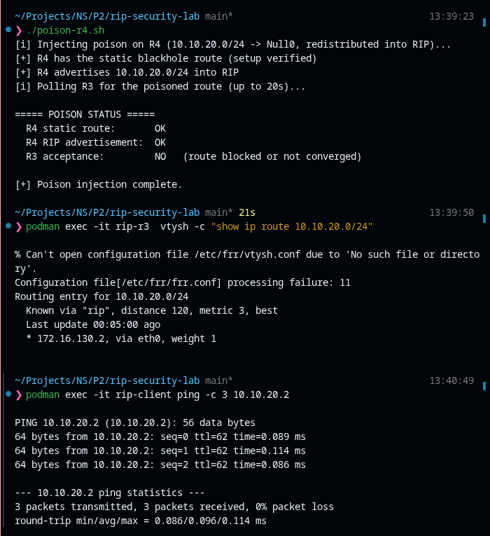
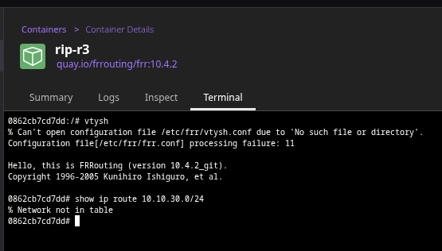

show ip route for both 10.10.20.0/24 (top) and 10.10.30.0/24 (middle) on R3 shows neither is installed, because R4's source IP is not on the TRUSTED_PEERS list. Client ping (bottom) succeeds.

Stronger than C in one important way: it is prefix‑agnostic. It rejects any prefix from an untrusted peer, so an attacker cannot bypass it simply by advertising a new prefix. C is more precise (it preserves the link for other prefixes if needed), E is more robust against novel attacks. In production, C and E are usually deployed together on the same interface.

### F Monitoring unexpected RIP updates
This control is detection, not prevention. It does not stop the attack; it records that an unexpected RIP update arrived, with the source IP and the advertised prefix. That evidence is what a SOC would use to correlate the attack with the connectivity failure observed from the client.

```bash
podman compose down -v --remove-orphans
podman network prune -f
podman compose up -d --force-recreate

# 1. Turn on RIP packet debug on R3
vtysh 
debug rip packet

# 2. Start a continuous capture on the R3-R4 link from the helper container
podman exec -it rip-check-tcpdump tcpdump -n -i any udp port 520

# 3. Trigger the attack
./poison-r4.sh          # POISON STATUS: R3 acceptance = YES (no prevention is applied)

sleep 4

# 4. Read the log — expect R4's IP and the fake prefix
podman logs --tail 50 rip-r3 2>&1 | grep -i "rip\\|172.16.140.3"
``` 

results 

- Routing table on R3:	Fake route installed (monitoring does not block)
- RIP traffic	Recorded: R4's update from 172.16.140.3 advertising 10.10.20.0/24 is in the log
- Connectivity:	ping fails (attack still effective)
- Forwarding path	Still diverted to R4
- Alerting evidence	Log line with source IP 172.16.140.3 and prefix 10.10.20.0/24

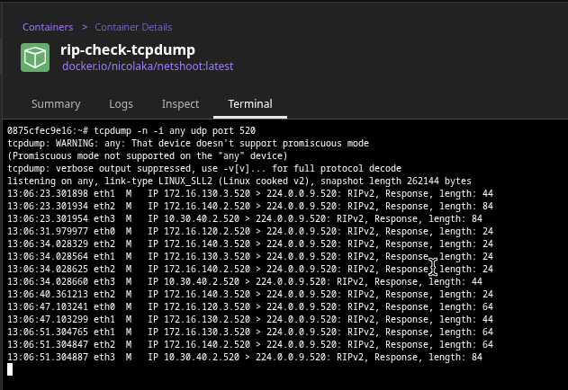
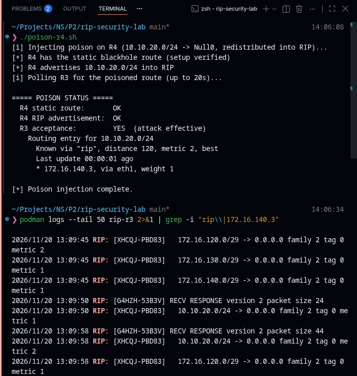

in the packet capture shows R4's RIP response advertising 10.10.20.0/24 on UDP/520, captured on the R3-R4 link. The attack still succeeds at the data plane (client ping fails in the same terminal), but the anomaly is recorded with the source IP and the advertised prefix, which is what feeds an alert.

 Monitoring is necessary but not sufficient, it does not protect the control plane. It becomes part of the defence when paired with A/C/D/E/G: the filter blocks the update, the monitor proves the block and identifies the attacker. In production this control is implemented with NetFlow/IPFIX sampling, syslog correlation, or a dedicated NMS watching for source IPs that are not in the authorised peer inventory.


### G RIP MD5 authentication

R3 requires MD5 authentication on eth1 (toward R4). Legitimate peers must share the key; R4 does not have it, so its unauthenticated updates are dropped by R3 before they can reach the routing process. To keep the legitimate path working, the R2-R3 adjacency is also authenticated — RIP authentication is per‑interface, so this is a targeted change on two interfaces.

```bash
podman compose down -v --remove-orphans
podman network prune -f
podman compose up -d --force-recreate

# R2: authenticate on eth1 (toward R3)
vtysh 
conf t
key chain RIPKEY
 key 1
  key-string ripsecret
exit
interface eth1
 ip rip authentication mode md5
 ip rip authentication key-chain RIPKEY
end


# R3: authenticate on eth0 (toward R2) AND eth1 (toward R4)
vtysh 
conf t
key chain RIPKEY
 key 1
  key-string ripsecret
exit
interface eth0
 ip rip authentication mode md5
 ip rip authentication key-chain RIPKEY
interface eth1
 ip rip authentication mode md5
 ip rip authentication key-chain RIPKEY
end

# R4 is NOT configured with the key → its updates are unauthenticated
./poison-r4.sh          # expected POISON STATUS: R3 acceptance = NO

podman exec -it rip-r3  vtysh -c "show ip route 10.10.20.0/24"
podman exec -it rip-r3  vtysh -c "show ip rip status"
podman exec -it rip-client ping -c 3 10.10.20.2
``` 


result 
Routing table on R3:	Fake route not installed
RIP traffic:	R4's unauthenticated update is dropped; the authenticated R2 update is still accepted
Connectivity:	ping succeeds
Forwarding path:	Client → R3 → R2 → R1

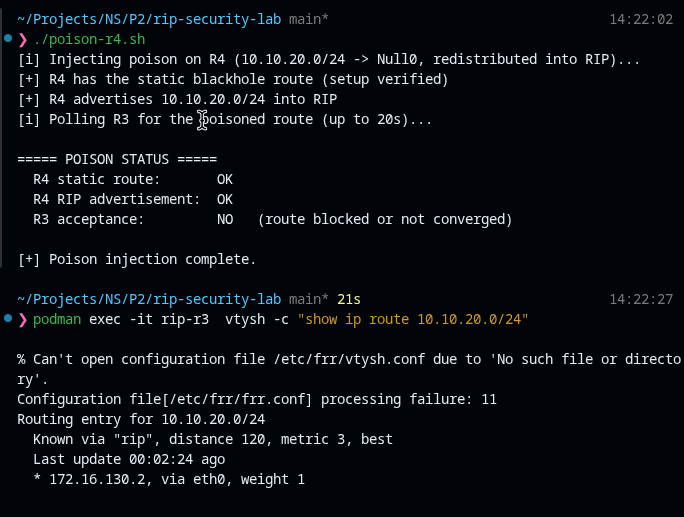
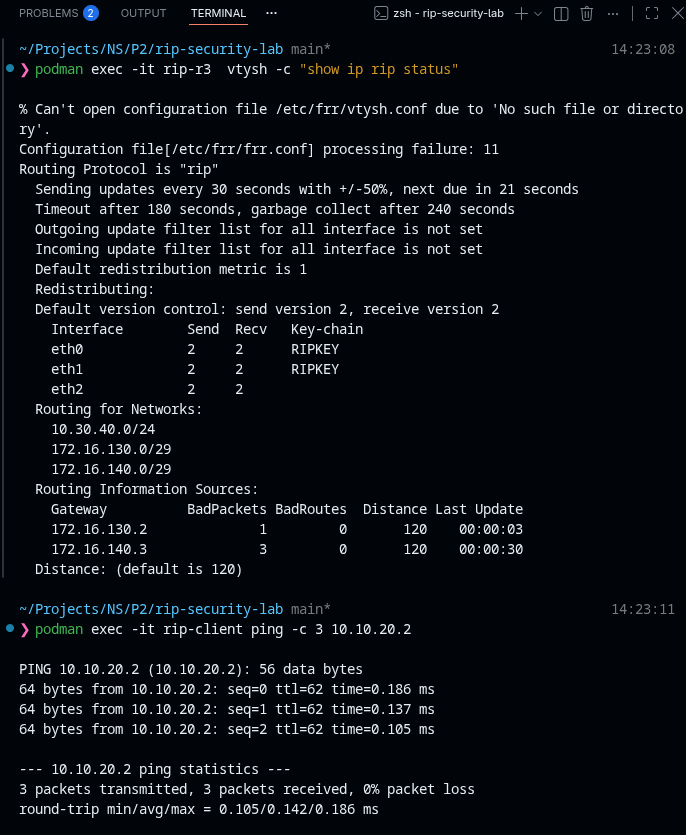

show ip rip status on R3 shows eth0 and eth1 with MD5 authentication active. Middle: show ip route 10.10.20.0/24 shows only the legitimate route via 172.16.130.2. Bottom: client ping -c 3 10.10.20.2 succeeds, the unauthenticated R4 update is silently dropped

Authentication is the most protocol‑native control: it does not rely on prefix or source-IP policy, it relies on possession of the shared secret. It is the only control here that also protects the legitimate peer R2-R3 adjacency against impersonation. Limitations: the key must be distributed out‑of‑band and rotated periodically, and plaintext MD5 (as used here) protects authenticity but not confidentiality of the routing updates themselves. In this lab, the effective pair is G (authenticate the untrusted link) + C or E (filter what authenticated peers can advertise), because a compromised peer that knows the key still needs a prefix‑ or source‑based filter to be constrained.


do a table comparing the implementation porfaplis :D  

