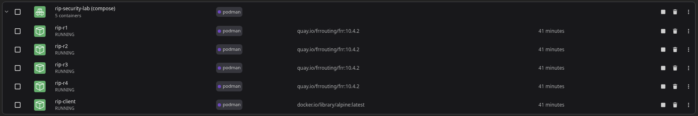
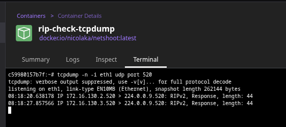
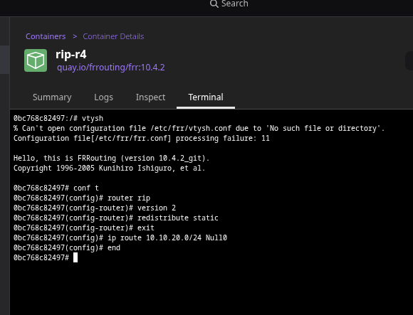
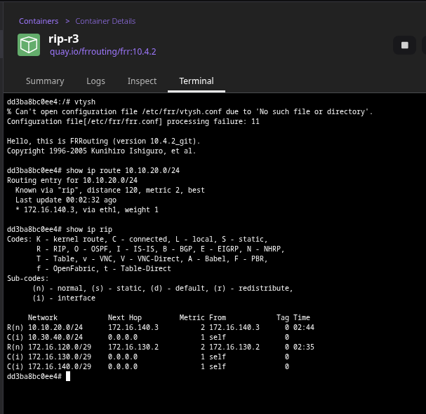
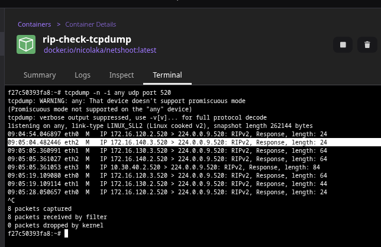
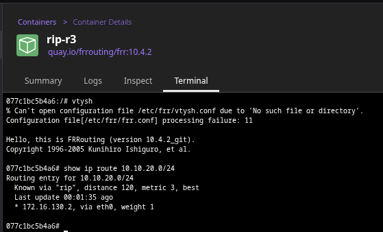
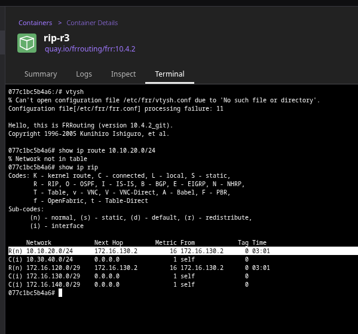

# Practice 2 - RIP security lab with Podman

I am doing this lab with 4 FRR routers and 1 client. My goal is to check normal RIP behavior, then inject a fake route, poison a route, and apply a basic mitigation.

## 1. Requirements

```bash
sudo apt update
sudo apt install podman podman-compose
podman --version
podman-compose --version
```

Requirements:

- podman 6.1.4-1.1
- podman-desktop 1.29.3-1.1
- podman-compose 1.6.0-1
- podman-docker 6.1.4-1.1
- quay.io/frrouting/frr:10.4.2

This lab was tested with FRR 10.4.2. In this image, `show ip protocols` does not work, so the correct command is `show ip rip`.

The Podman workaround is to use `/29` inter-router subnets instead of `/30` because Podman reserves the gateway and the point-to-point link pattern breaks in this environment.

## 2. Topology

Topology image:


IP plan:

- R1: `10.10.20.2` on `10.10.20.0/24`
- R1-R2: `172.16.120.0/29` -> `172.16.120.2` and `172.16.120.3`
- R2-R3: `172.16.130.0/29` -> `172.16.130.2` and `172.16.130.3`
- R3-R4: `172.16.140.0/29` -> `172.16.140.2` and `172.16.140.3`
- R3 client LAN: `10.30.40.0/24`
- Client: `10.30.40.10` with default via `10.30.40.2`

This is the same lab pattern as the original one, but the private addresses are adjusted to avoid host conflicts and Podman networking problems.

This is the same lab pattern as the original one, but the private addresses are adjusted to avoid host conflicts and Podman networking problems.

## 3. Why the Podman version is different

Podman keeps the subnet gateway and is stricter than a plain Docker lab. In practice, the original `/30` links were not working cleanly here because the gateway and broadcast addresses left no usable second host on the link.

So I changed the inter-router links to `/29` networks to keep the same lab logic but make it work in Podman.

## 4. Compose file

The `rip-security-lab/docker-compose.yaml` file is created as follows:

```yaml
services:
  r1:
    image: quay.io/frrouting/frr:10.4.2
    container_name: rip-r1
    privileged: true
    command: ["/bin/sh", "/tmp/router-start.sh"]
    volumes:
      - ./router-start.sh:/tmp/router-start.sh:ro
      - ./r1/daemons:/etc/frr/daemons:ro
      - ./r1/frr.conf:/etc/frr/frr.conf:ro
    networks:
      r1_r2:
        ipv4_address: 172.16.120.2
      r1_lan:
        ipv4_address: 10.10.20.2

  r2:
    image: quay.io/frrouting/frr:10.4.2
    container_name: rip-r2
    privileged: true
    command: ["/bin/sh", "/tmp/router-start.sh"]
    volumes:
      - ./router-start.sh:/tmp/router-start.sh:ro
      - ./r2/daemons:/etc/frr/daemons:ro
      - ./r2/frr.conf:/etc/frr/frr.conf:ro
    networks:
      r1_r2:
        ipv4_address: 172.16.120.3
      r2_r3:
        ipv4_address: 172.16.130.2

  r3:
    image: quay.io/frrouting/frr:10.4.2
    container_name: rip-r3
    privileged: true
    command: ["/bin/sh", "/tmp/router-start.sh"]
    volumes:
      - ./router-start.sh:/tmp/router-start.sh:ro
      - ./r3/daemons:/etc/frr/daemons:ro
      - ./r3/frr.conf:/etc/frr/frr.conf:ro
    networks:
      r2_r3:
        ipv4_address: 172.16.130.3
      r3_r4:
        ipv4_address: 172.16.140.2
      client_lan:
        ipv4_address: 10.30.40.2

  r4:
    image: quay.io/frrouting/frr:10.4.2
    container_name: rip-r4
    privileged: true
    command: ["/bin/sh", "/tmp/router-start.sh"]
    volumes:
      - ./router-start.sh:/tmp/router-start.sh:ro
      - ./r4/daemons:/etc/frr/daemons:ro
      - ./r4/frr.conf:/etc/frr/frr.conf:ro
    networks:
      r3_r4:
        ipv4_address: 172.16.140.3

  rip-check-tcpdump:
    image: docker.io/nicolaka/netshoot:latest
    container_name: rip-check-tcpdump
    privileged: true
    command: ["sh", "-c", "sleep infinity"]
    networks:
      r1_r2:
        ipv4_address: 172.16.120.4
      r2_r3:
        ipv4_address: 172.16.130.4
      r3_r4:
        ipv4_address: 172.16.140.4
      client_lan:
        ipv4_address: 10.30.40.20

  client:
    image: alpine:latest
    container_name: rip-client
    privileged: true
    command: ["sh", "-c", "ip route del default via 10.30.40.1 || true; ip route replace default via 10.30.40.2; sleep infinity"]
    networks:
      client_lan:
        ipv4_address: 10.30.40.10

networks:
  r1_r2:
    ipam:
      config:
        - subnet: 172.16.120.0/29
  r2_r3:
    ipam:
      config:
        - subnet: 172.16.130.0/29
  r3_r4:
    ipam:
      config:
        - subnet: 172.16.140.0/29
  r1_lan:
    ipam:
      config:
        - subnet: 10.10.20.0/24
  client_lan:
    ipam:
      config:
        - subnet: 10.30.40.0/24

```


router start script is only for podman version 

```text 
#!/bin/sh

ip route del default via 10.10.20.1 || true;
ip route del default via 172.16.120.1 || true;
ip route del default via 172.16.130.1 || true;
ip route del default via 172.16.140.1 || true;
ip route del default via 10.30.40.1 || true;
sysctl -w net.ipv4.ip_forward=1;
apk update >/dev/null 2>&1 || true;
apk add --no-cache tcpdump >/dev/null 2>&1 || true;
exec /usr/lib/frr/docker-start
```  

## 5. FRR router config

The router configuration is stored in the FRR files for each container. This lab does not require a separate command-by-command section for every router; the working config is loaded automatically at startup from the matching `frr.conf` files.

Each router needs a `daemons` file like this:

```text
zebra=yes
ripd=yes
```

And the `frr.conf` files look like this:

R1:

```text
frr defaults traditional
hostname R1
log stdout
!
router rip
 version 2
 network 10.10.20.0/24
 network 172.16.120.0/29
!
```

- R1 advertises the destination LAN and the link toward R2.

R2:

```text
frr defaults traditional
hostname R2
log stdout
!
router rip
 version 2
 network 172.16.120.0/29
 network 172.16.130.0/29
!
```

- R2 is the transit router between R1 and R3, so it advertises both links.

R3:

```text
frr defaults traditional
hostname R3
log stdout
!
router rip
 version 2
 network 172.16.130.0/29
 network 172.16.140.0/29
 network 10.30.40.0/24
!
```

-  R3 connects the core path to the client LAN and to R4, so it advertises both interfaces.

R4:

```text
frr defaults traditional
hostname R4
log stdout
!
router rip
 version 2
 network 172.16.140.0/29
!
```

- R4 is the attacker / malicious router in this lab, and it only needs to advertise its side of the R3-R4 link.

## 6. Start the lab

```bash
cd rip-security-lab
podman compose down -v --remove-orphans
podman network prune -f
podman compose up -d --force-recreate
podman ps
```

If the lab was previously created with a different subnet size or an older /30 layout, do a full cleanup before starting again. In Podman, stale networks are often the reason the route tables look fine in the config but fail during the rebuild.

The lab should show 6 containers running:



- rip-r1
- rip-r2
- rip-r3
- rip-r4
- rip-check-tcpdump
- rip-client

## Phase 1: Normal RIP operation

At the end of this phase, students should confirm that the destination network is reachable and that the routing tables contain the expected RIP-learned route.

This is the baseline. The client should be able to reach `10.10.20.2`.

Before it worked correctly in Podman, the lab had a routing issue. The environment was adding stale default routes on the container interfaces, and IPv4 forwarding was disabled. RIP routes appeared, but traffic was not actually being forwarded, so the network looked active but it was not passing packets.

The fix is simple, remove the unwanted default routes and enable `net.ipv4.ip_forward=1` before starting FRR.

Important fix for Podman:

- remove stale default routes on the interfaces
- enable IPv4 forwarding

This issue is shown in the Podman subnet problem image:


If the network does not forward traffic, this is usually the issue in this environment.

Check R3 with:

```bash
vtysh
show ip route
show ip rip
```


Then test from the client:

```bash
ping -c 3 10.10.20.2
traceroute 10.10.20.2
```


Now I want to check the RIP traffic itself. This helps confirm that the routers are really exchanging routing updates on UDP port 520, not just that the routes appear in the routing table. The FRR router image does not include `tcpdump`, and in Podman the router namespaces are not the easiest place to capture from. For that reason, I create a small helper container called `rip-check-tcpdump` using `docker.io/nicolaka/netshoot:latest`, because that image already contains networking tools like `tcpdump`, `ip`, and `ping`. It is attached to the same lab networks so we can capture the traffic without changing the router config.

```bash
tcpdump -n -i eth1 udp port 520
```




Things to check in this phase:

- R3 has a route to `10.10.20.0/24`
- the client can ping `10.10.20.2`
- the path is `Client -> R3 -> R2 -> R1`
- RIP is active 

## Phase 2: Malicious route manipulation

Students must determine:
- Whether R3 receives the false routing information.   
- What metric is associated with the advertised route.   
- Whether R3 changes its preferred route.   
- Whether the forwarding path changes.   
- Whether communication with the destination network is affected.   
- What security consequences result from accepting unauthorized routing information.  

In this phase, R4 is introduced as a controlled malicious router. R4 is connected to R3 through the `172.16.140.0/29` link and participates in the same RIP domain. The objective is to show the security problem of accepting routing information from an untrusted router.

R4 introduces false routing information for the legitimate destination network `10.10.20.0/24`. Students monitor R3 while the manipulated route is injected.

On R4, inject the fake route:

```bash
vtysh
conf t

router rip
version 2
redistribute static
exit
ip route 10.10.20.0/24 Null0
end
```

dont use write, its shit, hard to undo the process, becomes messy, Halp me :C



Then check on R3:

```bash
vtysh
show ip route 10.10.20.0/24
show ip rip
```



and check the RIP traffic capture
```bash
tcpdump -n -i any udp port 520
```



and do again the ping in the client 

```bash
ping -c 3 10.10.20.2
```


The traffic is no longer going to the real `10.10.20.2` server. It is being sent toward the fake route, and therefore the client loses connectivity.

In this phase, the proof is not only the route table. It is the combination of three checks: R3 shows the malicious route in `show ip route`, the RIP update is seen in `tcpdump` as coming from `172.16.140.3`, and the client ping fails because the path has been redirected to the blackhole route advertised by R4. Together these results show that the malicious router is influencing the forwarding decision and that trust in unauthorised RIP information can disrupt traffic.

Things to check in this phase:

- whether R3 receives the false route
- what metric is associated with the advertised route
- whether R3 changes its preferred route
- whether the forwarding path changes
- whether communication to `10.10.20.0/24` is affected
- what security consequences result from accepting unauthorised routing information


## Phase 3: Route poisoning with metric 16

Students should record the routing table before, during, and after the failure and capture the
corresponding RIP updates.

This phase is done after a clean rebuild. In Podman, shutting down only one side of the link is not reliable, so both sides of the R1-R2 link must be brought down.

First, rebuild the lab:

```bash
podman compose down -v --remove-orphans
podman network prune -f
podman compose up -d --force-recreate
```

Then check that the baseline is working before the failure.

On R3:

```bash
vtysh
show ip route 10.10.20.0/24
```



On the client:

```bash
ping -c 3 10.10.20.2
```

The ping should work. If the route is not visible immediately, wait a few seconds and check again. In Podman, FRR may need a short time to converge.

Now disable both ends of the R1-R2 link:

On R1 and R2:

```bash
ip link set dev eth0 down
```

Then check R3 again:

```bash
vtysh
show ip route 10.10.20.0/24
show ip rip
```



Expected result: the route is marked as poisoned with metric 16, for example `R(n) 10.10.20.0/24 ... metric 16`.

This is the key point: in RIP, a metric of 16 means the route is poisoned or unreachable. If we see `metric 16`, Phase 3 is working.

Then restore the link on both sides:

```bash
ip link set dev eth0 up
```

Check again on R3:

```bash
vtysh
show ip route 10.10.20.0/24
show ip rip
```


This is the Phase 3 proof for this Podman lab: route poisoning appears only after a clean rebuild and a failure on both ends of the R1-R2 link. Record the route state before, during, and after the failure.

## Phase 4 - Mitigation

This phase repeats the malicious-route experiment from Phase 2, but now a basic protection is applied on R3. The objective is to show that a router can ignore a fake RIP update coming from an untrusted interface.

Start with a clean rebuild so no stale RIP state remains from the previous phase.

```bash
cd rip-security-lab
podman compose down -v --remove-orphans
podman network prune -f
podman compose up -d --force-recreate
```

Then confirm the normal baseline before the attack:

```bash
podman exec -it rip-r3 vtysh
show ip route 10.10.20.0/24
show ip rip
```

From the client:

```bash
podman exec -it rip-client ping -c 3 10.10.20.2
```

The route should be the normal one via `172.16.130.2`, and the ping should succeed.

Now inject the fake route from R4:

```bash
podman exec -it rip-r4 vtysh
conf t
router rip
 version 2
 redistribute static
exit
ip route 10.10.20.0/24 Null0
end
```

Check the route on R3 again:

```bash
podman exec -it rip-r3 vtysh
show ip route 10.10.20.0/24
show ip rip
```

The route should now be learned from `172.16.140.3`, and the client should lose connectivity:

```bash
podman exec -it rip-client ping -c 3 10.10.20.2
```

This is the malicious state from Phase 2. The next step is the mitigation.

Apply the protection on the interface that receives the fake RIP update, which is the R3-R4 link (`eth1`).

On R3:

```bash
podman exec -it rip-r3 vtysh
conf t
router rip
 version 2
 passive-interface eth1
end
show running-config
show ip rip
```

This makes the R3-R4 link passive, so R3 stops accepting new RIP updates from the malicious router on `eth1`.

Important: `passive-interface` only blocks new RIP updates. It does not delete a route that was already learned and installed in the R3 routing table.

If the malicious route is still in the routing table, the lab is still carrying the old learned route. In that case, the cleanest way to prove the mitigation is to rebuild again or remove the fake static route on R4 before checking the client again.

For this lab, the easiest and safest approach is to rebuild again before testing the mitigation result:

```bash
cd rip-security-lab
podman compose down -v --remove-orphans
podman network prune -f
podman compose up -d --force-recreate
```

Then repeat the attack and mitigation flow and check that the client ping works again after the fake route is ignored.

Use the helper container for the capture:

```bash
podman exec -it rip-check-tcpdump tcpdump -n -i any udp port 520
```

This captures the RIP traffic and shows whether updates are still arriving from the malicious router.

Then, from the client:

```bash
podman exec -it rip-client ping -c 3 10.10.20.2
```

The expected result after mitigation is that R3 no longer prefers the fake route and the client can reach `10.10.20.2` again.

One capture is taken per phase.

### Phase 1
- `podman ps` *
- `show ip route` on R3 *
- `show ip rip` on R3 *
- `ping -c 3 10.10.20.2` from the client *
- `tcpdump -n -i any udp port 520` on R3 *

### Phase 2
- `show ip route` on R3 *
- `show ip rip` on R3 *
- client result after the fake route appears *

### Phase 3
- route before and after the R1-R2 link is shut down *
- `show ip rip` showing the poisoned route *
- check packet numbers is the most important *

### Phase 4
- route table after mitigation *
- final `ping -c 3 10.10.20.2` *


